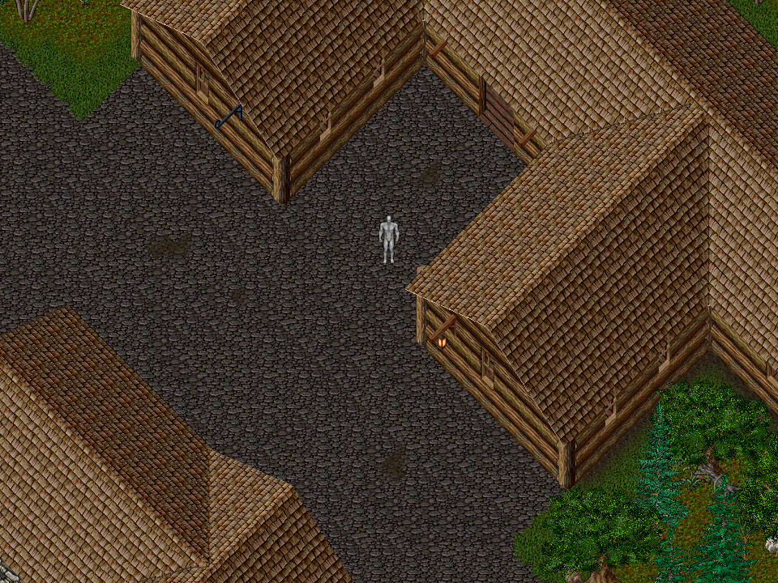
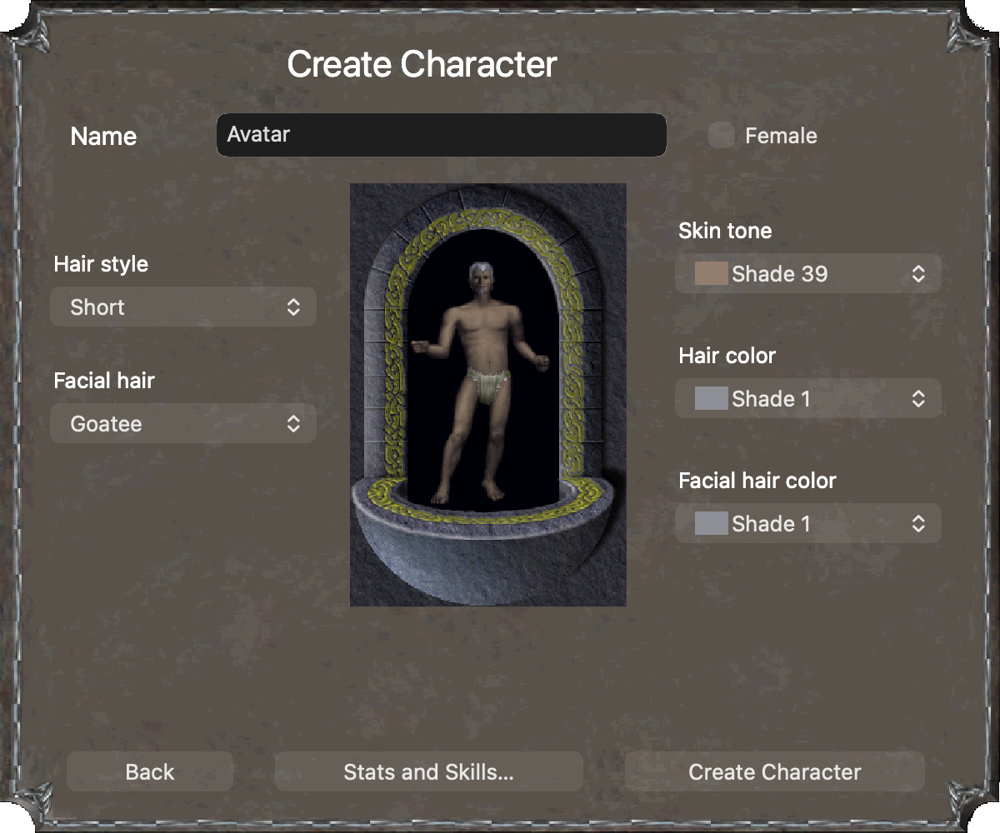
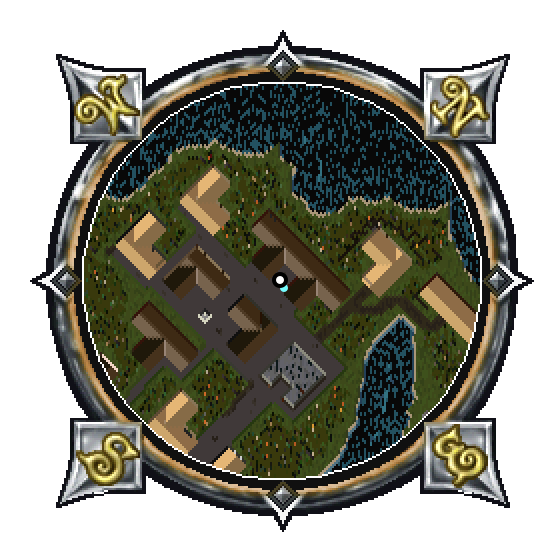
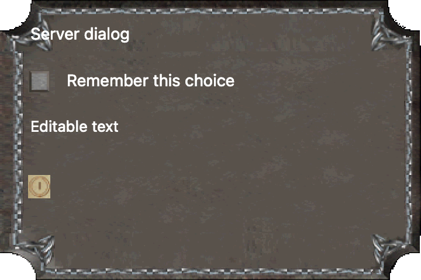

# UltimaXB

A native **Swift macOS client for classic Ultima Online**, with the original Xbox
as a later target. The current integration target is UO1998 and its 1.25.32-era
protocol. This is an independent work in progress, not an official UO client.



The client connects to a shard, enters the world, renders terrain and animated
characters with equipment, and supports movement, containers, vendors, chat,
targeting, skills, and basic spell/combat interactions. **Full classic-client
parity is not finished.** See [status and remaining work](docs/STATUS.md).

## Run on macOS

Requires macOS 13+ and Swift 6; developed with Swift 6.3.3 on Apple Silicon.
There are no external Swift package dependencies.

1. Obtain your own compatible classic UO asset installation. Game assets,
   installers, music, account data, and server data are **not included**.
2. Put the assets in `uo1998-client/`, or pass their location with `--client`.
3. From the repository root:

```sh
swift run -c release UltimaMac --client uo1998-client --connect
```

The login screen defaults to `login.uo1998.com:5000`. Use your own shard account.
Server/account preferences stay in macOS preferences; an optionally remembered
password stays in macOS Keychain. Rebuilt unsigned binaries may prompt for
Keychain access. The optional `tools/run_macos.sh` launcher uses a consistent
local signing identity configured in ignored `build/signing-identity.txt` and
replaces the existing client from this workspace.

For offline exploration, omit `--connect`. To export a world view:

```sh
mkdir -p build
swift run -c release UltimaMac --client uo1998-client \
  --x 2477 --y 411 --render build/minoc.bmp
```

## Controls

| Control | Action |
| --- | --- |
| Arrows; hold two for diagonals | Walk |
| Shift / Caps Lock | Run preference; low stamina falls back to walking |
| Right mouse held | Move toward pointer |
| Click walkable ground | Plan a route |
| Shift-click an item | Approach and attempt pickup |
| Space / U | Use nearby object / equipped tool |
| Enter | Chat, including shard commands such as `bank` or `vendor buy` |
| P / B / K / S | Paperdoll / backpack / skills / spellbook |
| J | Scrollable session journal; also available from the paperdoll |
| A | War/peace mode |
| M | Map; double-click switches local/world view |
| Shift-click map | Route toward a distant destination |
| Escape or manual movement | Cancel automatic travel |
| H | Recenter on player |
| Command-L | Connection screen |

Travel plans local sections and may stop at large or inaccessible obstacles.
Server validation remains authoritative for movement and item operations.

## Screenshots

These are actual offline client renders and UI fixtures, not screenshots of an
unmodified original client. Artwork is loaded from a separately installed game.
The appearance preview uses optional 1.26-era UI assets; the world uses 1.25.32.

| Character appearance | Original radar frame |
| --- | --- |
|  |  |



## Development

```sh
swift test -c release
python3 -m unittest discover -s tests -p 'test_*.py'
```

Tests cover binary formats, packet framing, movement prediction, rendering order,
navigation, item transfers and dialog replies. Some checks use local game assets
or an explicitly enabled disposable local OUO instance; a checkout without these
fixtures cannot run every integration check. Tests do not log into your live shard
account. `tools/check_*.swift` contains additional AppKit and asset checks.

- `Sources/UOCore/`: assets, protocol, world model, navigation and rendering.
- `Sources/UltimaMac/`: AppKit client, overlays, input, audio and local settings.
- `tests/UOCoreTests/`: Swift tests; `tools/`: render and validation utilities.
- `src/`, `xbox/`, `CMakeLists.txt`: early C/SDL/nxdk scaffold, **not the Swift game
  port running on Xbox**.
- [Development history](docs/DEVELOPMENT.md): detailed experiments and implementation notes.

Telemetry is local metadata only under ignored `build/telemetry/`: action types,
packet IDs/lengths, counts and timings. Credentials, private chat, dialog text and
entered text are not recorded. Do not publish personal telemetry or asset files.

Reference projects include [ClassicUO](https://github.com/ClassicUO/ClassicUO),
[CrossUO](https://github.com/crossuo/crossuo), and [OUO](https://github.com/draxinar/ouo).
Notices for adapted material are retained in [LICENSES](LICENSES/). Game artwork
and trademarks belong to their respective owners; screenshots do not grant a
license to redistribute the game assets.
