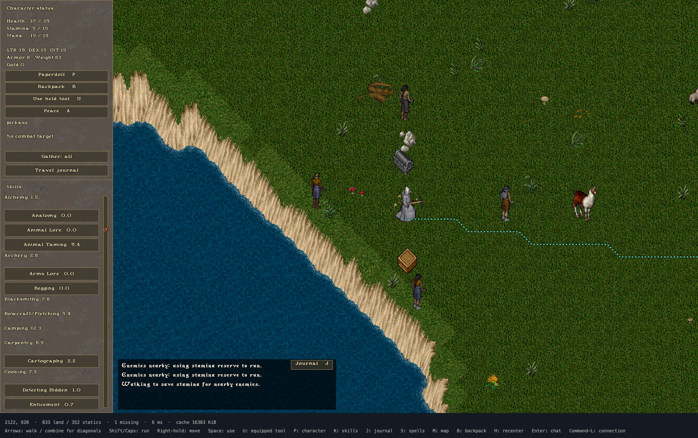
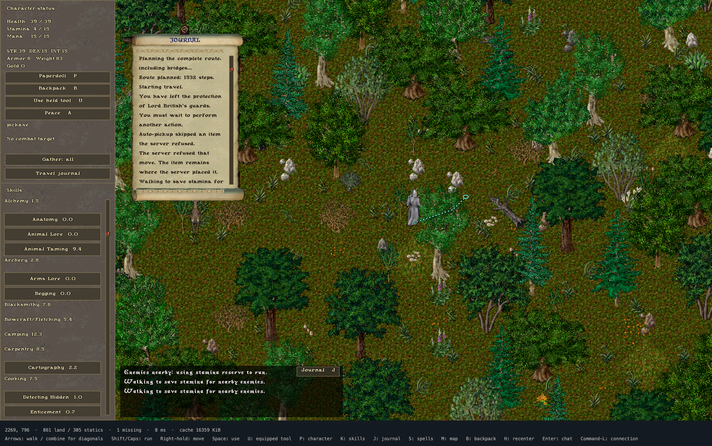
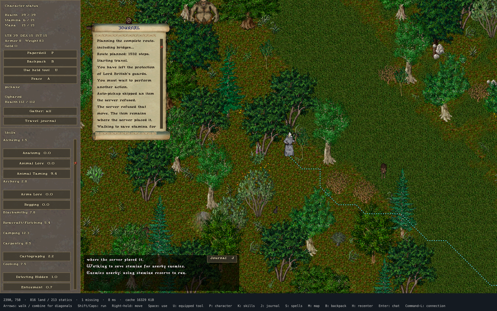
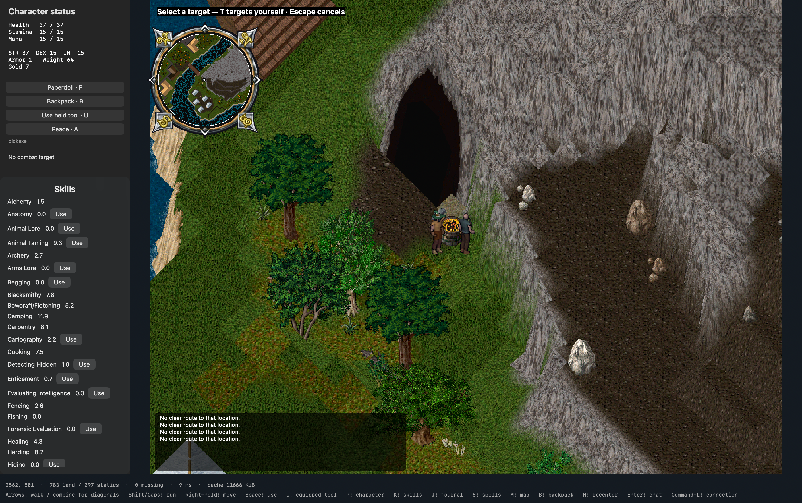
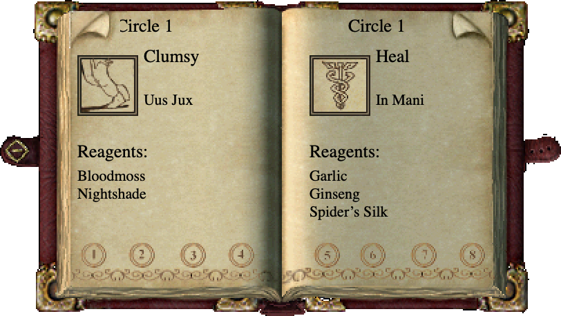
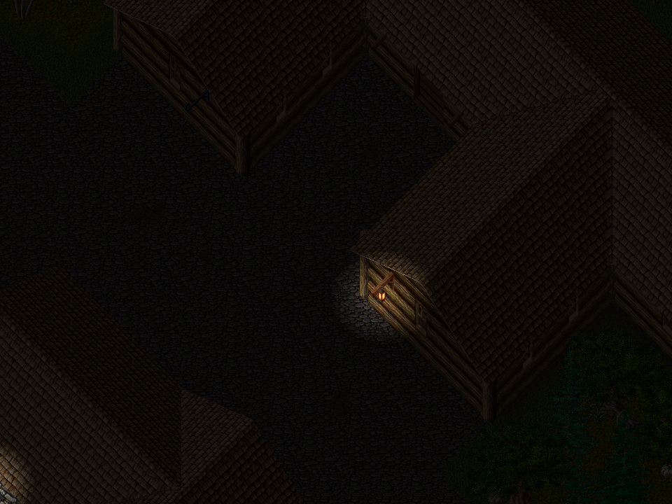
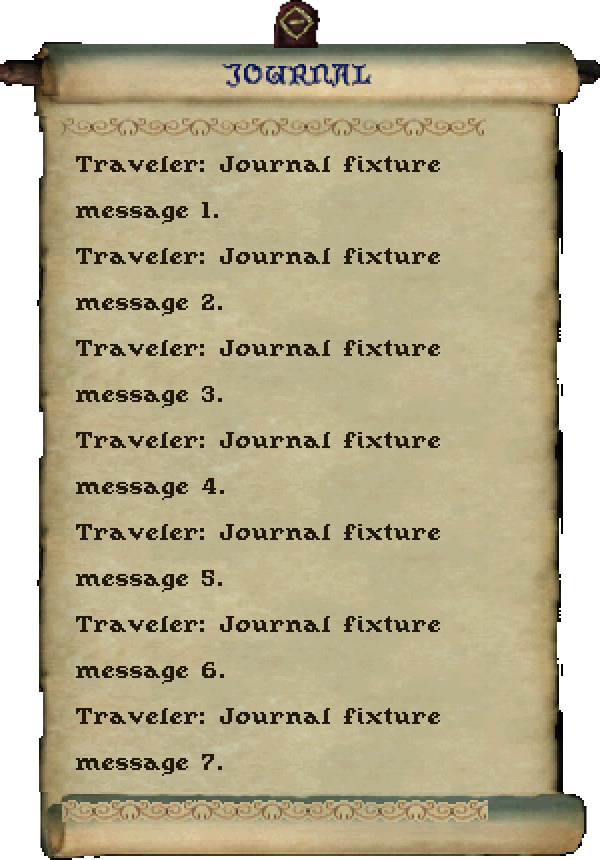

# UltimaXB

A native **Swift macOS client for classic Ultima Online**, with the original Xbox
as a later target. The current integration target is UO1998 and its 1.25.32-era
protocol. This is an independent work in progress, not an official UO client.



*Actual UO1998 session, October 19, 2026: automatic travel with a dotted route,
Gather enabled, classic bitmap UI, and stamina-reserve feedback.*

The client connects to a shard, enters the world, renders terrain and animated
characters with equipment, and supports movement, containers, vendors, chat,
targeting, skills, and basic spell/combat interactions. **Full classic-client
parity is not finished.** See [status and remaining work](docs/STATUS.md).

The goal also includes a [built-in assistant](docs/ASSISTANT.md), including
automatic travel, nearby ground-item gathering, and optional gathered-goods
banking and overload recovery. Automated mining, lumberjacking, herding, smelting
and crafting remain planned; the existing workflows still need live testing.

## Run on macOS

Requires macOS 13+ and Swift 6; developed with Swift 6.3.3 on Apple Silicon.
There are no external Swift package dependencies.

1. Obtain your own compatible classic UO asset installation. Game assets,
   installers, music, account data, and server data are **not included**.
2. Put the assets in `uo1998-client/`, or pass their location with `--client`.
3. From the repository root:

```sh
swift run -c release UltimaMac --client uo1998-client --connect
```

The login screen defaults to `login.uo1998.com:5000`. Use your own shard account.
Server/account preferences stay in macOS preferences; an optionally remembered
password stays in macOS Keychain. Rebuilt unsigned binaries may prompt for
Keychain access. The optional `tools/run_macos.sh` launcher uses a consistent
local signing identity configured in ignored `build/signing-identity.txt` and
replaces the existing client from this workspace.

For offline exploration, omit `--connect`. To export a world view:

```sh
mkdir -p build
swift run -c release UltimaMac --client uo1998-client \
  --x 2477 --y 411 --render build/minoc.bmp
```

## Local Spacetime server

The repository also includes an experimental **SpacetimeDB-backed UO 1.25.32
server**. It runs on loopback and uses the installed game assets for authoritative
terrain checks. The single-player sandbox persists movement, doors, containers,
equipment, ground items, stack transfers, food, lumberjacking, mining, forge
smelting, basic equipment recipes, skill progression, neutral-creature hunting, cooking, and a merchant with finite stock.

After installing the server prerequisites:

```sh
python3 server/local-spacetime/run.py
```

Connect to `127.0.0.1:2594` with the development account `local` / `local`.
The starter hatchet gathers logs from map trees; the dagger carves five logs into
a wooden shield. The pickaxe mines ore; the smith's hammer forges five ingots into
a nose helm. A persistent nearby forge also supports the client's smelting assistant.
Mara the provisioner sells apples and buys logs through the classic vendor windows.
Creature retaliation/player death, vendor restocking, multiplayer, and world merging remain future work.

See the [server setup and gameplay guide](server/local-spacetime/README.md),
[verification instructions](server/local-spacetime/README.md#verify), and
[development phases](server/local-spacetime/README.md#development-phases).
Runtime data, private credentials, and proprietary assets are excluded from Git.

## Controls

| Control | Action |
| --- | --- |
| Arrows; hold two for diagonals | Walk |
| Shift / Caps Lock | Run preference; low stamina falls back to walking |
| Right mouse held | Move toward pointer |
| Click walkable ground | Plan a route |
| Shift-click an item | Approach and attempt pickup |
| Space / U | Use nearby object / equipped tool |
| Enter | Chat, including shard commands such as `bank` or `vendor buy` |
| P / B / K / S | Paperdoll / backpack / skills / spellbook |
| J | Scrollable session journal; also available from the paperdoll |
| A | War/peace mode |
| M | Map; double-click switches local/world view |
| Shift-click map | Route toward a distant destination |
| Escape or manual movement | Cancel automatic travel |
| H | Recenter on player |
| Command-L | Connection screen |

Click the journal artwork beside recent chat, press **J**, or scroll over recent
messages to browse session history in the original parchment journal. Incoming
messages preserve your reading position while you are scrolled back.

An Xbox-compatible controller detected by macOS can use the left stick/D-pad to
walk, RT to run, A to use the facing object, B to cancel, X for backpack, Y for
paperdoll, and LB for the equipped tool. The right stick moves the world cursor;
A confirms it when a tool or spell requests a target. Inventory/menu navigation
still uses the mouse. Release controls to neutral after switching back from
another app or chat.

Open the paperdoll (**P**) and click **HELP** to request the server help menu,
including any stuck/recovery options offered by the shard.

Open **Travel journal** in the sidebar to choose a town or edit a destination.
Travel plans a complete static route, including bridges, then resolves local
sections against visible obstacles. It prefers roads, falls back to a more direct
connectivity search, opens blocking doors, and reserves stamina for nearby enemies.
Optional gathering makes short detours to eligible items; banking and overload
recovery operate only on goods confirmed as automatically gathered this session.
Locked doors, disconnected islands and server refusals can still stop travel.
Server validation remains authoritative for movement and item operations.

## Screenshots

The lead image and the following travel captures are unedited game-window
screenshots from the connected UO1998 session on October 19, 2026. They show
actual navigation, including unfinished behavior and server refusal messages;
they are not staged renders. No desktop or login screen is included.

| Forest travel and classic journal | Continuing through the forest |
| --- | --- |
|  |  |

The three captures show progress through (2122,928), (2269,796), and (2390,758).
They document an active journey, not a claim that bank arrival or depositing
completed successfully.



*October 18 session: Minoc mine entrance, forge and equipped pickaxe.*

The images below are offline client renders and UI fixtures. Artwork is loaded
from a separately installed game. The appearance preview uses optional 1.26-era
UI assets; the world uses 1.25.32.


| Character appearance | Original radar frame |
| --- | --- |
|  |  |








## Development

```sh
swift test -c release
python3 -m unittest discover -s tests -p 'test_*.py'
```

Tests cover binary formats, packet framing, movement prediction, rendering order,
navigation, item transfers and dialog replies. Some checks use local game assets
or an explicitly enabled disposable local OUO instance; a checkout without these
fixtures cannot run every integration check. Tests do not log into your live shard
account. `tools/check_*.swift` contains additional AppKit and asset checks.

- `Sources/UOCore/`: assets, protocol, world model, navigation and rendering.
- `Sources/UltimaMac/`: AppKit client, overlays, input, audio and local settings.
- `tests/UOCoreTests/`: Swift tests; `tools/`: render and validation utilities.
- `src/`, `xbox/`, `CMakeLists.txt`: early C/SDL/nxdk scaffold, **not the Swift game
  port running on Xbox**.
- [Development history](docs/DEVELOPMENT.md): detailed experiments and implementation notes.

Telemetry is local metadata only under ignored `build/telemetry/`: action types,
packet IDs/lengths, counts and timings. Credentials, private chat, dialog text and
entered text are not recorded. Do not publish personal telemetry or asset files.

Reference projects include [ClassicUO](https://github.com/ClassicUO/ClassicUO),
[CrossUO](https://github.com/crossuo/crossuo), and [OUO](https://github.com/draxinar/ouo).
Notices for adapted material are retained in [LICENSES](LICENSES/). Game artwork
and trademarks belong to their respective owners; screenshots do not grant a
license to redistribute the game assets.

For a private world with adjustable skills/stats and a starter kit, see the
[local Test Center instructions](docs/LOCAL_SERVER.md).
